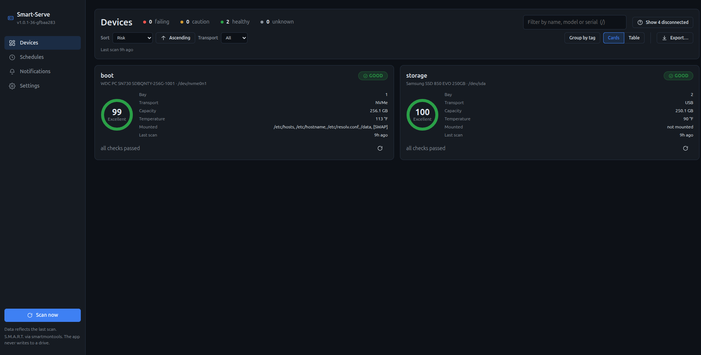
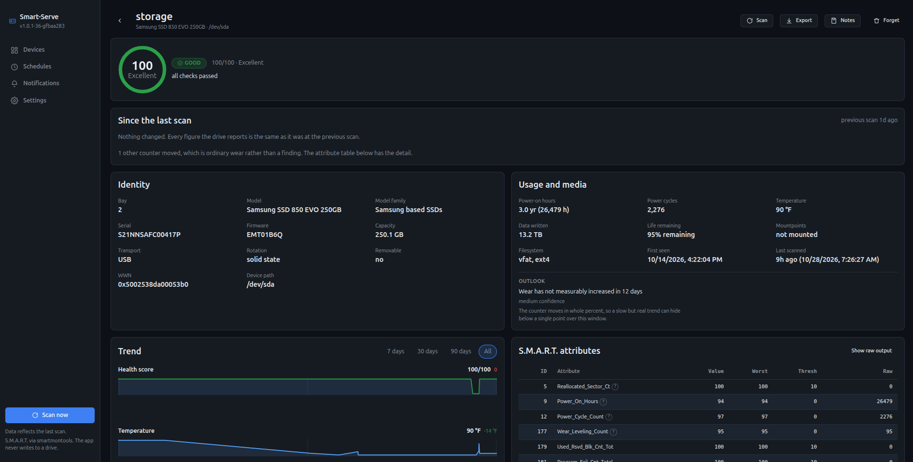
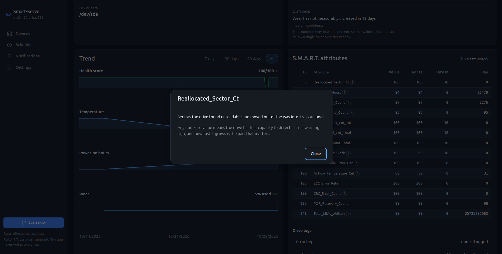
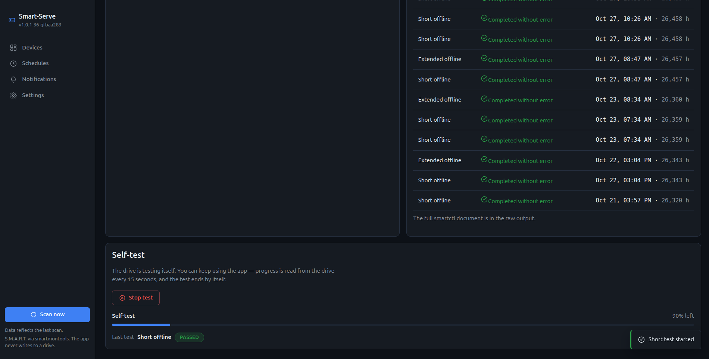

# Smart-Serve

A lightweight, self-contained Docker web application that reports S.M.A.R.T. health
information for **all** storage devices visible to the host — internal SATA/NVMe drives
*and* USB-attached drives. If it shows up in `lsblk`, it shows up in the web interface.

Smart-Serve is deliberately built to be **out of the way**: a single Go binary that idles
at ~0% CPU and ~10–15 MB RAM. It only wakes up when you look at it, when you press
**Scan**, or when a scheduled scan fires. No polling loops, no metrics scrapers, no
database daemon.



## Feature highlights

- **On-demand scanning** — a Scan button that immediately enumerates every connected
  device (`smartctl --scan-open` + `lsblk` cross-referenced) and pulls full S.M.A.R.T.
  data for each.
- **Scheduled scanning** — configure recurring S.M.A.R.T. scans (interval or cron-style)
  from the web UI. The scheduler lives inside the container; no host cron needed.
- **CrystalDiskInfo-style readouts** — Good / Caution / Bad verdicts per drive, per-
  attribute detail, temperature, a 0–100 health score, and per-metric trend
  sparklines (health score, temperature, power-on hours, wear) with a 7/30/90-day
  range selector.
- **Drive naming & notes** — name your drives ("boot", "backup pool") and save free-form
  notes per device. Identity is keyed by serial number, so notes survive reboots, replug
  events, and device-letter changes.
- **Export anywhere** — plain text (the format to attach to a warranty claim), a
  self-contained web page, a spreadsheet, or JSON. A report says what it is for and names
  the evidence a claim needs: the attributes failing the drive's **own** manufacturer
  threshold, and the counters the app reads. The whole fleet exports as one CSV to sort, or
  as one printable page.
- **Alert notifications** — get notified when a drive's health state changes. ntfy,
  Gotify, Telegram, Discord, email (SMTP) and generic webhooks; health-transition
  events with squelching so a failing drive doesn't spam you on every scan, and
  maintenance windows for planned work.
- **Tiny footprint** — single static Go binary, embedded frontend, SQLite storage in
  one file, and a small Alpine-based image: about **15 MB compressed**, 54 MB on disk
  (`ADR-020`).
- **Clean, themable UI** — a sleek, navigable interface designed as a first-class
  requirement: dark / light / auto, Catppuccin, Dracula, Nord, Gruvbox, Synthwave,
  Hacker, Solarized, Tokyo Night and One Dark palettes, plus a custom accent colour —
  and a theme picker that never touches component code (`docs/UI.md`).

## Screenshots

**A device page** — verdict, score, identity, usage, and the trend sparklines.



**Attribute help** — every attribute the interpreter acts on carries a `?` explaining what it is
and how to read it.



**A self-test running** — the one place the UI reads a drive live, and only while a test it
started is still running.



## Quick start

```bash
docker run -d \
  --name smart-serve \
  -v /dev:/dev:ro \
  -v smartserve-data:/data \
  -p 8080:8080 \
  --device-cgroup-rule='a *:* rwm' \
  --cap-add SYS_ADMIN \
  --cap-add SYS_RAWIO \
  --restart unless-stopped \
  ghcr.io/masieono/smart-serve:latest
```

> The three device flags are **not optional**. Mounting `/dev` only makes the nodes
> *visible*; without the cgroup rule every `open()` returns `EPERM`, and without the two
> capabilities a native NVMe read and a USB-bridge read each fail separately. All three
> fail identically, which is why they are listed together — see
> [`docs/DEPLOYMENT.md`](docs/DEPLOYMENT.md) for least-privilege options and USB specifics.

> **Smart-Serve ships no authentication, by design** (`ADR-016`). It expects a reverse
> proxy to provide it. Publishing port 8080 as above is appropriate on a trusted LAN and
> nowhere else.

Then open `http://<host>:8080` and press **Scan**.

## Documentation

| Document | Contents |
|---|---|
| [`docs/DESIGN.md`](docs/DESIGN.md) | Architecture, process model, scan pipeline, scheduler, resource budget |
| [`docs/SCOPE.md`](docs/SCOPE.md) | Feature tiers: MVP, Phase 2, Phase 3 backlog |
| [`docs/DATA_MODEL.md`](docs/DATA_MODEL.md) | SQLite schema, retention policy, migrations |
| [`docs/API.md`](docs/API.md) | Internal REST + SSE API specification |
| [`docs/SMART_INTERPRETATION.md`](docs/SMART_INTERPRETATION.md) | How SMART values become CrystalDiskInfo-style verdicts and longevity estimates |
| [`docs/NOTIFICATIONS.md`](docs/NOTIFICATIONS.md) | Event catalog, the six channel adapters, squelching and maintenance windows |
| [`docs/DEPLOYMENT.md`](docs/DEPLOYMENT.md) | Docker options, device access, security notes, USB guidance |
| [`docs/DECISIONS.md`](docs/DECISIONS.md) | Architecture Decision Record (ADR) log |
| [`docs/REQUIREMENTS.md`](docs/REQUIREMENTS.md) | Requirements traceability, decisions, considerations, assumptions |
| [`docs/FEATURES.md`](docs/FEATURES.md) | Full feature catalog & suggestions (tiers, idle-cost impact) |
| [`docs/UI.md`](docs/UI.md) | UI/UX design: navigation, components, theming, screen specs, accessibility |
| [`docs/KNOWLEDGE.md`](docs/KNOWLEDGE.md) | The drive knowledge base: file format, the three layers, what a pattern matches |
| [`docs/TESTING.md`](docs/TESTING.md) | Manual test checklist, and the data to set up first — most of the UI is conditional |
| [`docs/RELEASE.md`](docs/RELEASE.md) | Release checklist, screenshot list, image-size and arm64 verification notes |
| [`CHANGELOG.md`](CHANGELOG.md) | What changed in each release |

## Development

`make ci` runs exactly what CI runs, in the same order, so a green run locally means a
green run there:

```bash
make ci
```

That target is four steps and nothing else. On a machine without `make` — a server, a
container — run them directly; they are identical:

```bash
gofmt -l .                                 # prints anything unformatted; must be empty
go vet ./...
go test -count=1 ./...
node --test internal/webui/jstest/*.test.mjs
```

You need Go (the version in `go.mod`) and Node 24. Nothing else.

| Target | Does |
|---|---|
| `make ci` | the four checks above |
| `make build` | builds `bin/smart-serve`, stamped with `git describe` |
| `make docker` | builds the image locally as `smart-serve:dev` |
| `make test-js` | JavaScript tests only |

**These checks are not how you deploy.** Running the app is `docker compose up -d --build`
or the `docker run` above (`docs/DEPLOYMENT.md`). The checks are for changing the code, and
they run in CI on every push whether or not you run them yourself.

## Project status

**MVP complete, plus the Phase 2 and Phase 2.5 tiers.** Every `SCOPE.md` MVP item is built,
along with history and trending, longevity estimates, the fleet views, the drive's own logs
and self-tests, the knowledge base, and the notification work. What is *not* built — and why —
is listed in [`docs/SCOPE.md`](docs/SCOPE.md).

Decisions are recorded in [`docs/REQUIREMENTS.md`](docs/REQUIREMENTS.md) (D1–D27, C1–C24) and
[`docs/DECISIONS.md`](docs/DECISIONS.md) (ADR-001–ADR-023). Image:
`ghcr.io/masieono/smart-serve`. CI: GitHub Actions.

### What is built

- **The core loop** — discover, interpret, persist, display, schedule, alert. Go module and
  domain model, the interpretation engine (verdicts, 0–100 score, longevity projection),
  smartctl/lsblk wrappers, scan orchestration, SQLite persistence, HTTP API + SSE, and the web
  UI. All unit-tested (`internal/…`).
- **The drive's own data** — self-test (short/long, live progress, abort), the error and
  self-test logs, and the raw `smartctl` output (`A19`/`A20`).
- **Notifications** — ntfy, Gotify, Telegram, Discord, SMTP and webhooks; transition events
  with squelching, maintenance windows, per-channel subscriptions, acknowledgement, action
  buttons, and a weekly digest as a schedule action (`B1`–`B13`).
- **Export** — per drive as text / web page / spreadsheet / JSON, and the whole fleet as one
  CSV or one printable page (`A8`/`A23`/`A27`).
- **Fleet views** — filter and sort, a dense table, grouping by tag, bay/slot, a "replace
  first" ranking, correlated-change detection, and a testing session for bench drives
  (`D5`/`D8`/`D9`/`D10`/`D11`/`A24`/`A25`).
- **Knowledge base** — rated endurance and known firmware advisories: a bundled table, an
  opt-in refresh, and your own entries, every figure carrying its source (`A21`).
- **Ops** — Dockerfile, compose (prod + dev), GitHub Actions CI, Prometheus `/metrics` (off by
  default), config import/export, and multi-arch (amd64/arm64) images.

### Validated on real hardware

Device access works against a native NVMe, a USB-attached NVMe, a USB-attached SATA SSD, a
native SATA SSD, and a USB flash drive that reports no S.M.A.R.T. at all — which is reported as
such rather than as a failure (`docs/DEPLOYMENT.md`). Measured idle cost on a long-running
instance with no browser open: **0.00% CPU, 13.4 MiB RSS**.

## License

The application source is licensed under the **MIT License** — see [`LICENSE`](LICENSE).

The published container image bundles **smartmontools** (`smartctl`), which is
licensed **GPLv2**; the image ships its license text and a pointer to its
corresponding source. The app invokes `smartctl` as a separate process, so the two
are aggregated, not linked (`docs/DECISIONS.md` ADR-012).
